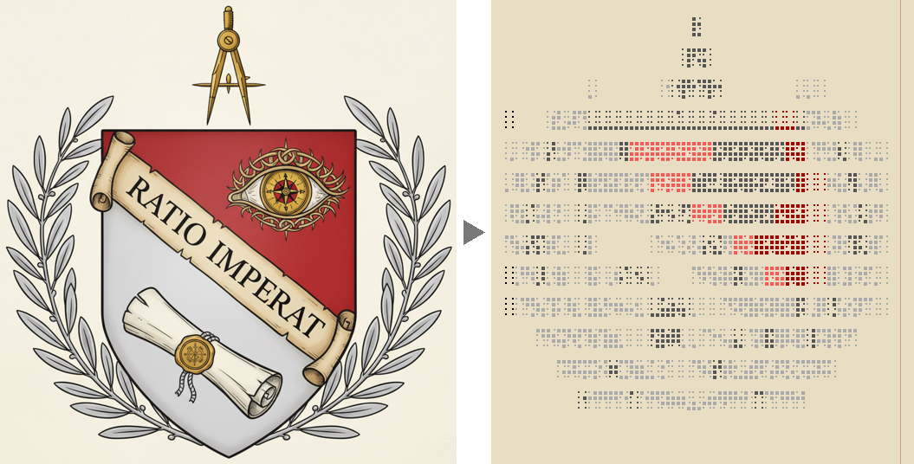
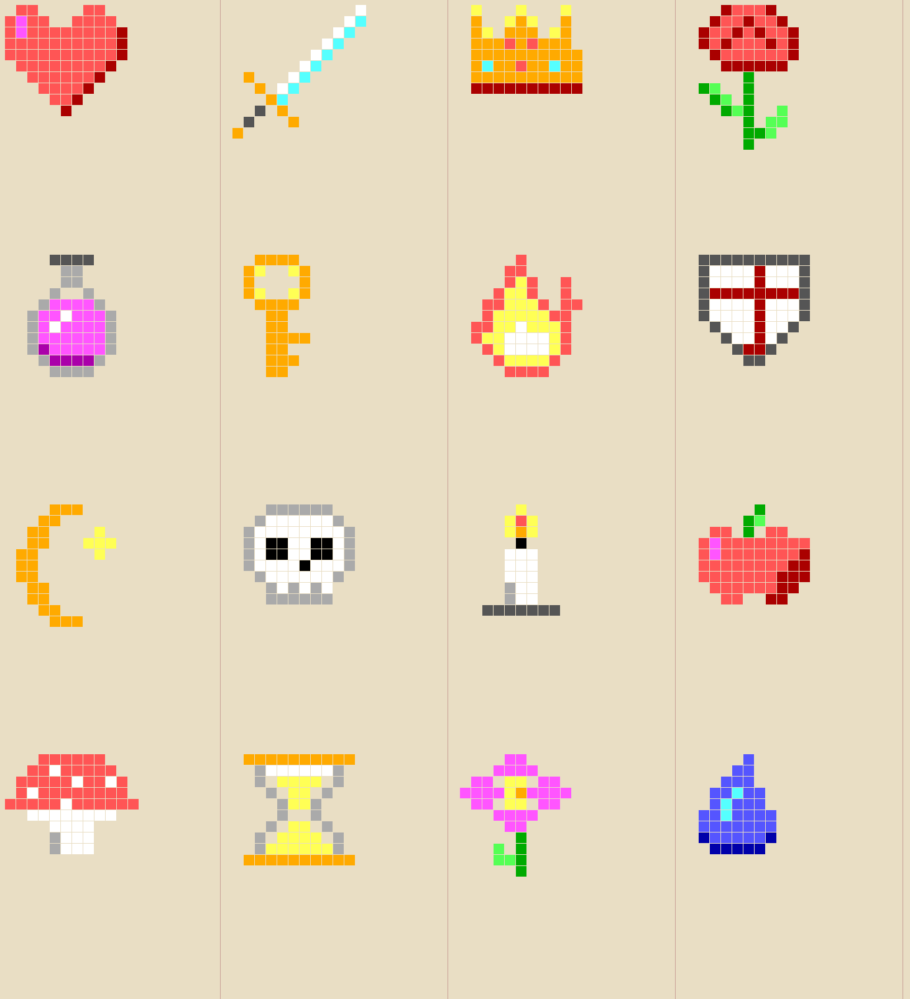
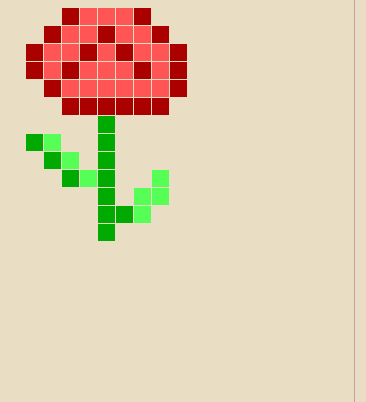
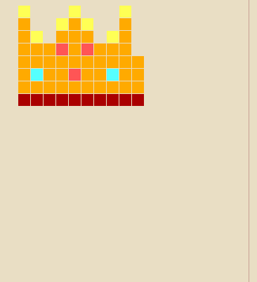
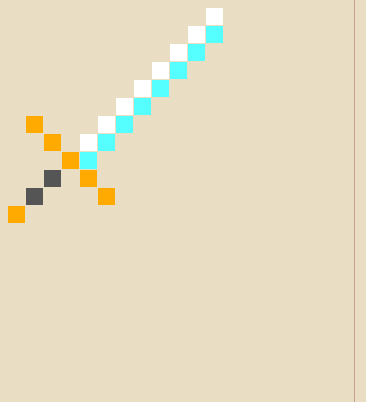

# Картинка в книгу

Программа превращает картинку в текст, который рисует её на странице книги Minecraft. Кидаете PNG в окно, подкручиваете ползунки, нажимаете «Скопировать для книги» и вставляете в книгу.

Сделано под Minecraft 1.21.8: ширина каждого знака взята из шрифта самой игры, поэтому превью в окне показывает страницу так, как её нарисует игра.



## Что умеет

- **Цветные блоки** – сетка до 12×14 клеток из `█ ▀ ▄ ▐` в 16 цветах книги. Лучше всего для пиксель-арта и иконок.
- **Точки Брайля** – до 74×56 точек, чёрно-белые или цветные. Разрешение выше, подходит для гербов, силуэтов и рисунков с крупными цветными пятнами.
- Пиксель-арт до 24×28 пикселей переносится пиксель в пиксель, без растягивания.
- Яркость, контраст, насыщенность, порог точек, удаление фона по цвету углов, дизеринг.
- Счётчик знаков: страница вмещает 1024.
- Картинку можно перетащить прямо в окно.

## Примеры

Пиксель-арты, нарисованные только цветами книги (лежат в [`pixelart`](pixelart), готовые тексты для вставки – в [`pixelart/out`](pixelart/out)):



| Роза | Корона | Меч |
|---|---|---|
|  |  |  |

Текст герба из первой картинки – [`examples-text/Герб Сильверхеймов.txt`](examples-text/Герб%20Сильверхеймов.txt).

## Установка

Нужен Python 3.10 или новее.

```
pip install -r requirements.txt
```

Запуск – `BookArt.bat` (картинку можно бросить и на него) или `pythonw book_art.py`.

## Как вставить в книгу

1. Откройте книгу и перо.
2. Выравнивание по левому краю. Если в программе стоит галочка «Строки одной ширины», можно и по центру.
3. Ctrl+V.

Цвета записываются кодами `§`, а обычный редактор книги их вырезает. Для цветных картинок нужен редактор, который их понимает, например [Roleplayer's Quill](https://codeberg.org/Glam_Ardor/roleplayers-quill): многострочная вставка в нём переносит коды как есть. Чёрно-белый Брайль кодов не содержит.

## Что получится, а что нет

Хорошо выходит:
- пиксель-арт и иконки 16×16–24×28;
- 2–4 ярких цвета: красный, золотой, жёлтый, зелёный, голубой, синий, фиолетовый, чёрный;
- простой силуэт на однотонном или прозрачном фоне.

Плохо выходит:
- фотографии и мелкие детали;
- коричневые, бежевые и пастельные тона – таких цветов в книге нет, они становятся серыми или красными;
- белое и светлое – сливается с бумагой.

## Как это устроено

Ширины знаков сняты с кода и ассетов 1.21.8:

- `█ ▀ ▄ ▐ ▒ ▓` берутся из `ascii.png` и сдвигают строку на 9 px. Пустой `U+3000` приходит из Unifont и сдвигает тоже на 9, поэтому клетки цветного режима стоят ровно.
- Знаки Unifont занимают `(ширина закрашенной части) / 2 + 1` px и рисуются от своего левого закрашенного столбца. Поэтому `▖ ▗` и другие частичные блоки сжимаются и съезжают и для картинок не годятся.
- Брайль занимает 3 px. Пустая клетка Брайля в Unifont 16 рисует мелкие точки, поэтому пустые места набираются `U+2007` (5 px), `U+3000` (9 px) и пробелом (4 px).
- Игра переносит строку только на пробеле, а страница шириной 114 px, так что ни одна строка картинки за край не выходит.

Отсюда и разница со старыми конвертерами под 1.14: там Брайль рисовался другим шрифтом.

## Лицензия

Код – MIT, см. [LICENSE](LICENSE).

`fontdata.json` содержит глифы Брайля из [GNU Unifont](https://unifoundry.com/unifont/) (SIL OFL 1.1 / GPL-2.0-or-later с исключением для шрифтов) и шесть блочных глифов из `ascii.png` Minecraft. Иконка – текстура книги и пера из Minecraft. Minecraft – товарный знак Mojang; проект с Mojang не связан.
