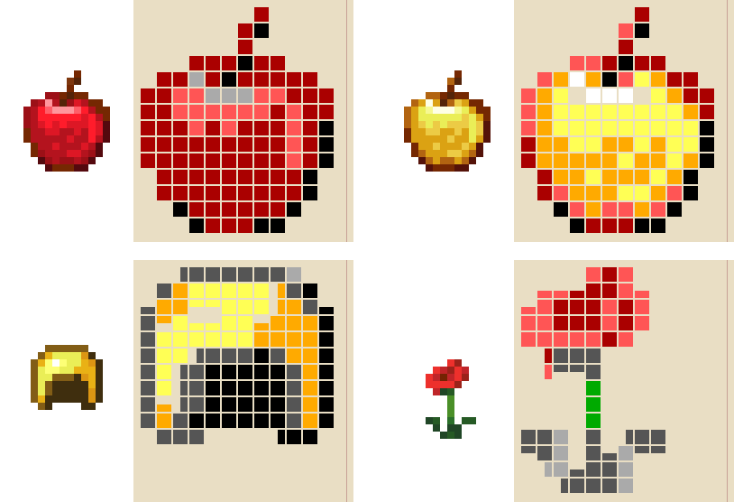

# Book Art

Turns a picture into text that draws it on a Minecraft book page. Drop a PNG into the window, adjust the sliders, press "Copy for the book" and paste it into a book.

Made for Minecraft 1.21.8: the width of every character is taken from the game's own font, so the preview in the window shows the page exactly as the game will draw it.


## Features

- **Coloured blocks** – a grid of up to 12×14 cells made of `█ ▀ ▄ ▐` in the book's 16 colours. Best for pixel art and icons.
- **Braille dots** – up to 74×56 dots, black-and-white or coloured. Higher resolution, good for coats of arms, silhouettes and pictures with large patches of colour.
- Pixel art up to 24×28 pixels is transferred pixel for pixel, with no stretching.
- Brightness, contrast, saturation, dot threshold, background removal by the corner colour, dithering.
- Character counter: a page holds 1024.
- Pictures can be dragged straight into the window.

## Examples

Pixel art drawn only in the book's colours (in [`pixelart`](pixelart), ready-to-paste texts in [`pixelart/out`](pixelart/out)):


| Rose | Crown | Sword |
|---|---|---|
|  |  |  |

Minecraft 16×16 items as coloured blocks – apple, golden apple, golden helmet and poppy:



Ready-to-paste texts are in [`examples-text`](examples-text), including the coat of arms from the first picture.

## Installation

Requires Python 3.10 or newer.

```
pip install -r requirements.txt
```

Run `BookArt.bat` (you can also drop a picture onto it) or `pythonw book_art.py`. The interface is in Russian.

## Pasting into a book

1. Open a book and quill.
2. Align left. If "Строки одной ширины" (equal-width lines) is ticked in the program, centred works too.
3. Press Ctrl+V.

Colours are written as `§` codes, and the vanilla book editor strips them. Coloured pictures need an editor that understands them, for example [Roleplayer's Quill](https://codeberg.org/Glam_Ardor/roleplayers-quill): its multi-line paste keeps the codes as they are. Black-and-white Braille has no codes.

## What works and what doesn't

Works well:
- pixel art and icons from 16×16 to 24×28;
- 2–4 bright colours: red, gold, yellow, green, aqua, blue, purple, black;
- a simple silhouette on a plain or transparent background.

Works badly:
- photos and fine detail;
- brown, beige and pastel tones – the book has no such colours, so they turn grey or red;
- white and light colours – they blend into the paper.

## How it works

Character widths are taken from the 1.21.8 code and assets:

- `█ ▀ ▄ ▐ ▒ ▓` come from `ascii.png` and advance the line by 9 px. The empty `U+3000` comes from Unifont and also advances by 9, so the cells of the colour mode line up exactly.
- Unifont characters advance by `(width of the drawn part) / 2 + 1` px and are drawn from their leftmost filled column. That is why `▖ ▗` and other partial blocks shrink and shift, and are useless for pictures.
- Braille advances by 3 px. An empty Braille cell in Unifont 16 draws tiny dots, so empty space is filled with `U+2007` (5 px), `U+3000` (9 px) and spaces (4 px).
- The game only wraps a line at a space, and the page is 114 px wide, so no line of a picture ever goes past the edge.

This is also the difference from the older converters made for 1.14: Braille was drawn by a different font back then.

## License

Copyright (C) 2026 Glam_Ardor. The code is licensed under the [GNU GPL version 3](LICENSE) or any later version: modified versions may be released, but they must keep the authorship, mark the changes and stay open source under the same license.

`fontdata.json` contains Braille glyphs from [GNU Unifont](https://unifoundry.com/unifont/) (SIL OFL 1.1 / GPL-2.0-or-later with the font embedding exception) and six block glyphs from Minecraft's `ascii.png`. The icon is Minecraft's book and quill texture. Minecraft is a trademark of Mojang; this project is not affiliated with Mojang.
